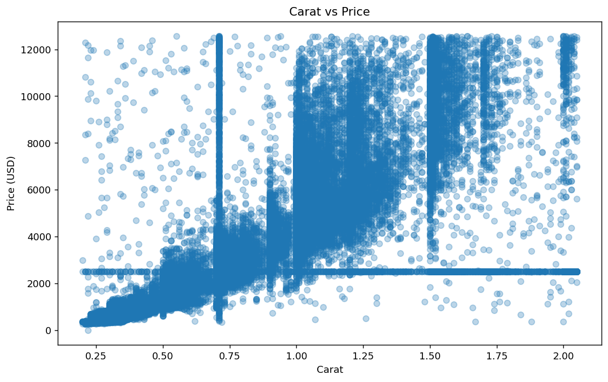
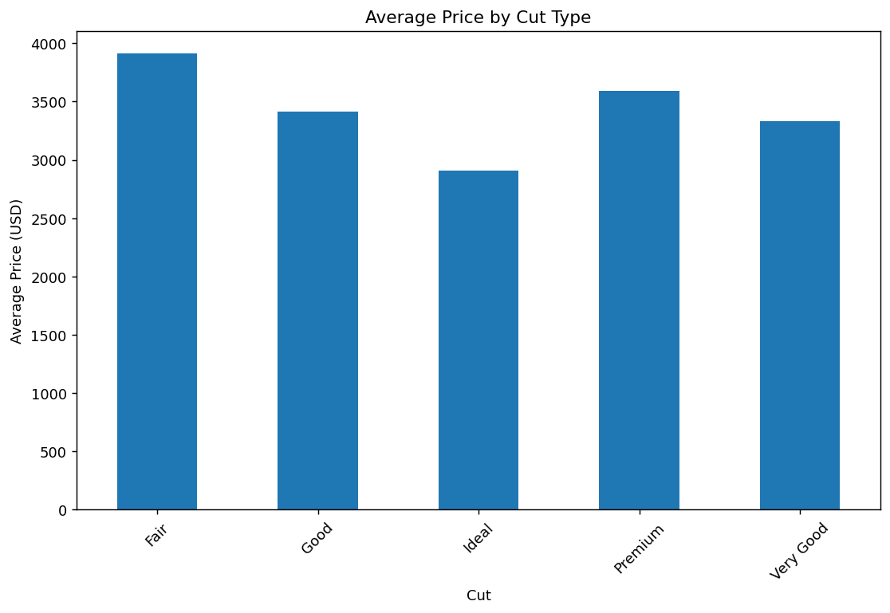

# Diamond Price Analysis

**Author: Dipesh Subedi** · Python · Data cleaning · Exploratory analysis · Hypothesis testing

An individual university analytics project exploring **55,843 diamond records**. The analysis examines how prices vary with carat, cut and clarity, addresses data-quality issues, and tests differences in average prices.

## Project questions

- How are carat and price related?
- How do average prices differ across cut and clarity categories?
- What does the price distribution look like?
- Is the mean price different from USD 4,000?
- Do Ideal and Premium cuts have different mean prices?
- Is the mean price of Fair cuts greater than that of Ideal cuts?

## Workflow

1. Import the data and inspect types, missing values and summary statistics.
2. Remove rows with missing values, duplicate records and invalid cut categories.
3. Identify numerical outliers using the interquartile range (IQR) and replace flagged values with each column's median, following the original coursework approach.
4. Explore the prepared dataset with scatter plots, bar charts, histograms and box plots.
5. Apply one-sample and independent two-sample t-tests at a 5% significance level.

The notebook focuses on exploratory analysis and statistical testing. Predictive modelling is not included.

## Selected results

The preparation steps retain **55,660 records**. All figures below describe the data **after median replacement of numerical outliers**, including prices.

| Measure | Result |
| --- | ---: |
| Mean prepared price | USD 3,259.60 |
| Mean Fair-cut price | USD 3,909.24 |
| Mean Premium-cut price | USD 3,591.26 |
| Mean Ideal-cut price | USD 2,911.10 |

| Test | Result at α = 0.05 |
| --- | --- |
| Mean price versus USD 4,000 | Reject the null hypothesis; the prepared-data mean differs from USD 4,000 |
| Ideal versus Premium mean price | Reject equal means; Premium has the higher sample mean |
| Fair mean price greater than Ideal | Reject the null hypothesis in favour of a higher Fair sample mean |

These findings describe associations within the prepared dataset. They do not establish that cut quality causes a price difference. Carat, clarity and other characteristics may differ between groups.

## Visual examples





For a retailer, these comparisons can guide further investigation of product mix and pricing. They are not sufficient on their own to set prices or establish a quality premium.

## Files

| File | Purpose |
| --- | --- |
| [Diamond_Price_Analysis.ipynb](Diamond_Price_Analysis.ipynb) | Analysis notebook with charts and test outputs |
| [data/data.csv](data/data.csv) | Supplied coursework dataset |
| [DATA_DICTIONARY.md](DATA_DICTIONARY.md) | Field descriptions and source ambiguities |
| [ANALYSIS_NOTES.md](ANALYSIS_NOTES.md) | Limitations and possible next steps |
| `images/` | Four charts regenerated from the supplied data |
| `requirements.txt` | Versions of the analytical packages used for verification, plus JupyterLab |

## Run the analysis

From the project directory, create an environment and install the dependencies:

```bash
python -m venv .venv
```

Activate it with `source .venv/bin/activate` on macOS/Linux, or `.venv\Scripts\Activate.ps1` in Windows PowerShell. Then run:

```bash
pip install -r requirements.txt
jupyter lab Diamond_Price_Analysis.ipynb
```

Run cells from top to bottom. The notebook reads `data/data.csv` relative to the project directory.

## Validation and provenance

All Python code cells were executed sequentially against the supplied CSV during portfolio preparation. The three test results matched the saved notebook outputs to numerical precision. Charts in `images/` were regenerated. Verification used Python execution with a noninteractive plotting backend; the Jupyter interface was not tested.

This project is based on my individual Macquarie University coursework. The notebook's original declaration stated that GenAI was not used in drafting or proofreading that submission. AI assistance was used later for GitHub packaging, documentation and execution checks. Analytical methods were preserved; the student number was removed, headings were simplified and the data path was updated.

The supplied dataset's original publisher and redistribution licence were not provided. No open-source licence is asserted for the dataset. Source metadata describes diamond attributes and USD prices; it does not name a retailer.
